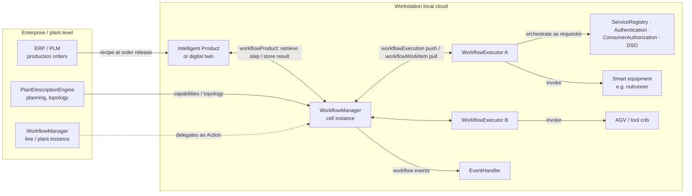
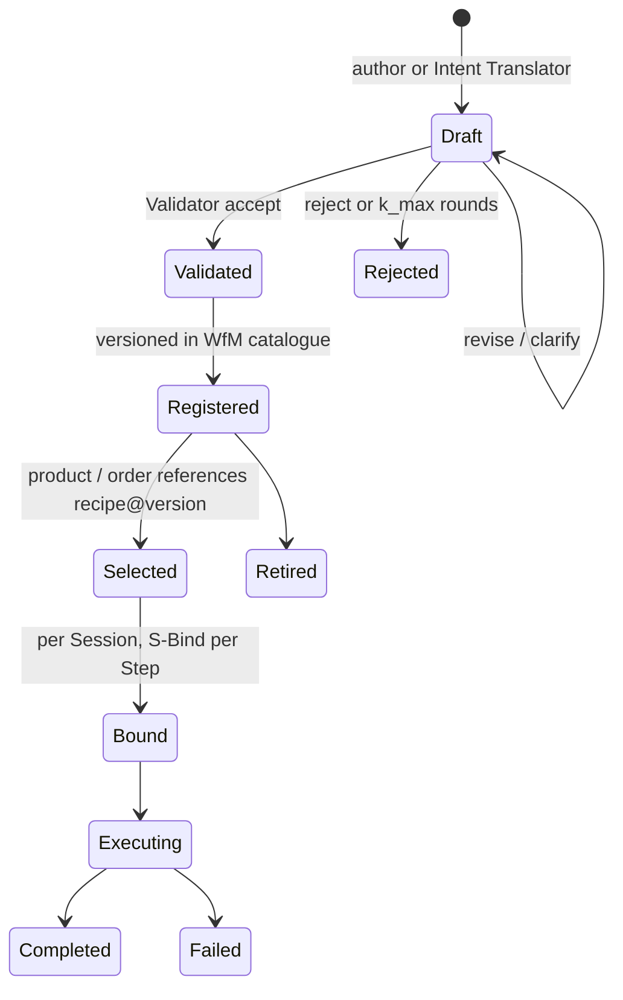

# Workflow Manager and Workflow Executor for Eclipse Arrowhead — architecture proposal

Status: architecture proposal of 2026-11-18. **Java implementation of option A (coexist with compatibility) since 2026-11-19**; §15 lists what is implemented and what is not. The Java tree is the reference implementation. **Go and Rust implementations do not exist yet, so the systems are not interoperable across the three implementations**; they must implement the same wire contracts (§11, README).

## 1 Purpose and scope

Eclipse Arrowhead binds services at run time, but it cannot state the **order and conditions** of service exchanges. Represa (Lic. 2022, Q1) shows this gap. Putting that logic in each consumer breaks loose coupling. Leaving it to a central MES brings back the bottleneck and single point of failure that Derhamy (2018) wanted to remove.

This proposal adds two systems to the Arrowhead 5 support-system set:

| System | Role in one line | Origin |
| --- | --- | --- |
| **WorkflowManager** (WfM) | Keeps the books. It holds recipes and workflow instances, validates and decomposes recipes, tracks progress, and reports to the product and to the plant. | Derhamy, Paper H: "book keeper", blackboard; Represa: workflow management system |
| **WorkflowExecutor** (WfE) | Initiates the work. It interprets one Action/Step state machine, has providers orchestrated for itself, invokes the equipment, and reports results. | Derhamy, Paper H: HATEOAS executor; Arrowhead 4.6 Choreographer Executor; Varga execution model |

These systems are **not** in scope: planning and scheduling (PlantDescriptionEngine or ERP), supply chain, quality policy authoring, and the equipment services themselves. Derhamy's separation of concerns applies: *Plant Description plans, the Workflow Manager sequences, Orchestration realises.*

## 2 Sources and what each one contributes

| Source | Contribution used here |
| --- | --- |
| H. Derhamy, *Architectural Design Principles for IIoT*, PhD thesis 2018, esp. §3.3, §3.5 and Paper H "Workflow Management for Edge Driven Manufacturing Systems" (ICPS 2018); defence slides 2018-05-29 | The three-system split: Smart/Intelligent Product, Workflow Manager, Workflow Executor. The WfM is a stateless blackboard, cloneable per work centre. The WfE is customised per workstation and talks to nothing outside its work centre. The product is the final arbiter of accepted work. The disconnected working copy is synchronised to the master later. Plug-and-produce. Interfaces RetrieveProcessStep, StoreProcessStepResult, StoreOperationResult, RetrieveOperation, DoJob and NotifyResult. The design principles: loose coupling, searchable, run-time binding, autonomy, specialisation, data at its source, first-person perspective. |
| J. Garcia Represa, *Workflows in Microservice Based System of Systems*, Licentiate 2022 | The ordering gap (Q1). Workflow management as a separate microservice-style system. Orchestration-style and choreography-style management can coexist in one SoS (Q2). Interoperable workflow expression (Q3). Workflows are selected, implemented and executed. Manufacturing workflows are mainly control-flow, with Russell's control-flow, data and resource perspectives. Volvo autonomous-workstation demonstrator. |
| P. Varga, *Arrowhead Workflow Choreography: A Formal Definition of Recipes and Their Execution Model*, Sensors 2026, 26, 7025, doi:10.3390/s26217025 | The formal recipe W = (P, A, S, θ, ι, μ, q, pre, η, qnty, dep, κ) and well-formedness (W1)–(W4). The session state z = (M, M_A, β, ε, ξ, status). Executor capabilities η and assignment ε, valid when (V1)–(V3) hold. The transition rules A-Start, S-Enable, S-Bind, S-Done, A-Finish, Z-Close, S-FailBind and S-FailInvoke. Lemmas 1–2, Theorem 1 (at most 3·\|S\| + 2·\|A\| transitions), Theorem 2 (progress), Proposition 1 (exclusive tool use). The stated limits: no recovery, qnty = 1, a single local cloud. The mapping to Choreographer 4.6.2 (Table 6). |
| Companion site <https://arrowhead-workflows.vercel.app> and `github.com/palvarga/arrowhead-workflows`, including P. Varga, *Intent-based Workflow Choreography* (under review) | Runnable kits. The session-context service. The lease variant of the tool crib. The Intent → Translator → Validator (I1–I2, V1–V10) → Compiler pipeline. Note that this paper's V1–V10 are recipe checks and are **not** the same as the Sensors paper's assignment-validity conditions (V1)–(V3). |
| `ah5-Choreographer-java-spring` 5.2.2 / 5.3.0 (this tree) | The current plan/session/executor engine. Executor contract `service-info`, `start` and `abort`. DSO push orchestration with the executor as target. Result codes SUCCESS, ERROR, FATAL_ERROR and ABORTED. |

> §6 was checked against the Sensors paper (`sensors-26-07025-v2.pdf`) on 2026-11-18. Where this proposal goes beyond the proven model (recovery, retries, timeouts, qnty > 1, leases, federation), §6.6 says so explicitly.

## 3 Design principles applied

| Principle (Derhamy §3.5) | Consequence for WfM/WfE |
| --- | --- |
| Loose coupling | Recipes name **service definitions and capabilities, never endpoints**. The WfE does not know a provider until orchestration time. |
| Searchable | WfM, WfE and the product register in ServiceRegistry. A WfE finds "its" WfM by orchestration, not by configuration. |
| Run-time binding | S-Bind happens per Step and per Session, with the step's consumer c_z(s) as requester: the assigned executor, or the WfM when η(s) is undefined (as Choreographer does with DSO). Plug-and-produce follows from this. |
| Autonomy | Each WfE handles bad paths: no provider, invocation failure, lease loss. Each WfM keeps working disconnected from the plant and enterprise level. |
| Specialisation | The WfM never invokes equipment. The WfE never stores recipes or talks outside its local cloud. |
| Data at its source | The recipe and the as-built record belong to the **product** (or its digital twin). The WfM holds a working copy and the execution trace, and pushes results back. |
| First-person perspective | Every interface is specified from the provider's point of view. Each system protects itself (it checks that a report comes from the claimant executor, among other things). |

## 4 System context



Deployment rules:

1. **One WfM per work centre local cloud.** It is generic: the same image with a different `workstation.id`. Plant- or line-level WfM instances are optional. They delegate whole Actions to a cell WfM, across local clouds through Gatekeeper/GateTunnel (§8).
2. **One or more WfE per workstation.** A WfE is the only workflow component that may need equipment-specific adapters (legacy equipment). It never consumes services outside its local cloud (`localCloudOnly = true`).
3. **The product** provides the `workflowProduct` service: an embedded ECU, an RFID-backed digital twin, or an adapter to the factory control system (Derhamy's "FCS adapter" migration path).

## 5 Workflow model

### 5.1 Recipe (design time)

The recipe is Varga's formal Recipe extended with the policy fields the Arrowhead Choreographer already has. The canonical exchange format is JSON ([model/recipe.schema.json](model/recipe.schema.json)). It is the same document in Java, Go and Rust. This answers Represa's Q3 (interoperable workflow expression) for the Arrowhead ecosystem.

Varga's recipe (Sensors 2026, §4):

```
W  = (P, A, S, θ, ι, μ, q, pre, η, qnty, dep, κ)        P = (name, A, α0, next_A)
α  = (S_α, F_α, next_α)    F_α = { s ∈ S_α | pre(s) = ∅ }
σ(s) = (θ(s), ι(s), μ(s), q(s), pre(s), η(s), qnty(s))   service definition, interface,
                                                          metadata, QoS, predecessors,
                                                          optional executor capability, multiplicity
dep: S → 2^S   (data dependency, separate from the control dependency pre)
κ_s: 𝒫 × D^dep(s) → D   (input composition from session parameters ρ and results ξ|dep(s))
```

Well-formedness, checked statically before any session:

- (W1) G_A is a single directed path from α0: acyclic, out-degree ≤ 1, every Action reachable.
- (W2) The step sets are finite and pairwise disjoint, and every G_α is acyclic.
- (W3) pre is derived from next_α, and F_α is exactly the set of Steps with no predecessor.
- (W4) dep(s) ⊆ { p | p ≺ s }. A step may consume results of its transitive predecessors in the same Action, or of any Step in an earlier Action.

The recipe is **immutable**. Bindings, executor assignments and results belong only to Sessions.

The JSON form adds these fields on top of the paper's W:

- `version`. Recipes are catalogued and selected by version.
- `resources` R: shared resources that need a lease (e.g. tool NR7).
- `parameters`: a declaration of ρ.
- `policy`, with `timeout`, `retry`, `lease` and `quantity`. These are **extensions outside the proven model** (§6.6).

Mapping to the JSON fields:

- θ, ι, μ and q map to `service.serviceDefinition`, `interfaces`, `metadata` and `qos`.
- η maps to `executor.capability`. Leaving it out means the WfM itself is the consumer (c_z(s) = CH_i).
- κ_s maps to `input`, a template that refers to results by step name. When `input` is given, `dep` is inferred from it.

[examples/shared-tool-tightening.recipe.json](examples/shared-tool-tightening.recipe.json) expresses the Varga forklift example (3 Actions, 9 Steps) in this format.

### 5.2 Mapping to the existing Choreographer plan

| Recipe | `ChoreographerPlanRequestDTO` (5.2.2) |
| --- | --- |
| `name` | `name` |
| `firstAction` | `firstActionName` |
| `action.next` | `nextActionName` |
| Steps with no predecessor | `firstStepNames` (derived) |
| `step.next` | `nextStepNames` |
| `step.service` | `serviceRequirement` |
| `step.dep`, `step.name` | `staticParameters.dep`, `staticParameters.step` |
| `step.policy.quantity` | `quantity` |
| `exec`, `lease`, `retry`, `timeout`, `version` | *(no equivalent; WfM-only)* |

The mapping is lossy only for the WfM-only fields. The WfM can therefore **compile** a recipe to a Choreographer plan (Varga's Compiler) and run it on the existing Choreographer (compatibility profile, §9).

### 5.3 Workflow lifecycle

The lifecycle follows Represa's select → implement → execute stages, with Varga's validation in front:



**Validator.** The check set is pluggable. It ships the generic structural checks and accepts domain checks as plug-ins:

| Group | Checks | Source |
| --- | --- | --- |
| Structural (always) | (W1)–(W4); unique names; `next` stays inside its Action; qnty = 1 unless the repeated-execution extension is enabled | Sensors paper §4.9; intent V1; Choreographer PlanValidator |
| Catalogue (always) | Every θ(s) exists in ServiceRegistry; when η(s) is defined, at least one registered WfE satisfies it (otherwise S-FailBind is certain); parameters valid for the service | intent I1, V2 |
| Authorisation dry run (always) | For each Step, c_z(s) may consume θ(s) and the dependencies | intent V3; Sensors (A2) |
| Interface coverage (always) | `dep(s)` covers every result the service's input requires (`requiresResults`) | intent V9 |
| Resource (when R ≠ ∅) | Reserve ≺ every use ≺ release (the structural premise of Proposition 1); every lease-using Step depends on reserve; lease duration exceeds the longest nominal tool Step | intent V7, V8, V10; Sensors §8 |
| Domain plug-ins | e.g. "transport before configure", "no hard-coded program values", "tighten → evaluate + record", quality policy | intent V4–V6, I2 |

"Intent" refers to the V/I checks of the intent paper (companion repository). They are different from the Sensors paper's (V1)–(V3), which are conditions on executor assignment and hold by construction (§6.2).

The outcome is `accept | revise | clarify | reject`, with Varga's decision rule: reject wins, then clarify, then revise.

**Intent Translator (optional, later phase).** It is a separate client that turns an operator intent into a draft recipe, for example through AIGym or an LLM. It **never** bypasses the Validator: an LLM draft is just another `Draft`. Varga's run 1 was a false accept, which led to check V9. That is the argument for keeping the validator deterministic and authoritative.

## 6 Execution semantics

This section follows Varga, Sensors 2026, 26, 7025, §5. §6.1–§6.4 are the paper's model. §6.5–§6.6 are where this proposal goes beyond it.

### 6.1 Session

A **Session** is one execution of one immutable recipe version for one subject: a product unit, a control period, or a batch. Its state is

```
z = (M, M_A, β, ε, ξ, status)
M   : S → {inactive, enabled, running, completed}      step marking
M_A : A → {inactive, active, completed}                action marking
β   : S → Π ∪ {⊥}                                      service binding (orchestration result)
ε   : S ⇀ WE                                           executor assignment
ξ   : S ⇀ D                                            stored step results
status ∈ {running, completed, failed}
```

The initial state z₀ has every step `inactive`, β = ⊥, ε and ξ empty, **α0 already `active`**, and status `running`. The session parameters ρ are fixed when the Session is created and are not part of z.

There is no `bound` or `failed` step marking. Binding happens in the same transition that makes a step `running`, and failure is recorded only in `status`.

**Consumer of a step.** c_z(s) = the WfM itself (the paper's choreographer CH_i) if η(s) is undefined, and the assigned executor ε(s) otherwise. Orchestration is always requested with c_z(s) as the consumer. Authorisation, QoS filtering and provider selection stay entirely with the Arrowhead orchestrator. The workflow layer adds coordination only, so it is a conservative extension of the framework.

### 6.2 Transition rules

All rules require status = running. Each rule moves exactly one marking, or the status. Parallel steps are modelled by interleaving. asg(z, s) = {z} if η(s) is undefined. Otherwise it is the set of states with ε(s) := w for each w ∈ WE with η(s) ∈ cap(w).

| Rule | Premise | Effect | WfM/WfE realisation |
| --- | --- | --- | --- |
| **A-Start** | M_A(α) = inactive, (α′, α) ∈ next_A, M_A(α′) = completed | M_A(α) := active | WfM. Never fires for α0, which starts active |
| **S-Enable** | M_A(α(s)) = active, M(s) = inactive, ∀p ∈ pre(s): M(p) = completed | M(s) := enabled | WfM; work item published or dispatched |
| **S-Bind** | M(s) = enabled, z′ ∈ asg(z, s), π = O(c_z′(s), compile(s, z′), γ, t) ≠ ⊥ | z′ with M(s) := running, β(s) := π | WfM chooses the executor (ε). Orchestration with the executor as requester (DSO push, as in Choreographer 5.2.2) |
| **S-Done** | M(s) = running, β(s) = π, consume(π, input(s, z)) = d′ ≠ fail | M(s) := completed, ξ(s) := d′ | WfE (or WfM when η undefined) invokes; WfE stores ξ(s) and reports `SUCCESS` |
| **A-Finish** | M_A(α) = active, ∀s ∈ S_α: M(s) = completed | M_A(α) := completed | WfM |
| **Z-Close** | ∀α ∈ A: M_A(α) = completed | status := completed | WfM; then pushes ξ and the trace to the product (side effect outside the model) |
| **S-FailBind** | M(s) = enabled, ∀z′ ∈ asg(z, s): O(…) = ⊥ (vacuously true if no executor satisfies η(s)) | status := failed | WfM |
| **S-FailInvoke** | M(s) = running, β(s) = π, consume(π, input(s, z)) = fail | status := failed | WfE reports `FATAL_ERROR` |

input(s, z) = κ_s(ρ, ξ|dep(s)). Lemma 2 guarantees that it is defined whenever s is enabled or running.

**Pending calls.** A call that has not been answered keeps the step `running`. Neither S-Done nor S-FailInvoke applies until the answer arrives, while other steps and Sessions keep moving. A blocking `ReserveTool` is represented this way. There is no "waiting" state.

**Failure is absorbing.** After S-FailBind or S-FailInvoke no rule applies. The model has no retry, re-orchestration or compensation.

**Guarantees** for well-formed recipes, without recovery and with qnty = 1:

- **Lemma 1.** Markings only increase. A non-inactive step has every p ≺ s completed. The assignment ε is always valid in the sense of (V1)–(V3).
- **Lemma 2.** A step never runs on missing data.
- **Theorem 1.** Every run has at most 3·|S| + 2·|A| transitions. A failure-free run ending in Z-Close has exactly that many. The count is A-Start for every Action except α0, plus three per Step, plus A-Finish per Action, plus Z-Close. That gives 11 transitions for temperature control (|S| = 3, |A| = 1) and 33 for the forklift recipe (|S| = 9, |A| = 3).
- **Theorem 2 (progress).** If status = running, some rule applies. This presupposes that every invocation eventually answers (consume is total).

The transition count is a progress indicator and a log-consistency check. It is **not a timeout**, because a pending call adds no transitions.

### 6.3 Result codes

| WfE → WfM | Model | WfM reaction |
| --- | --- | --- |
| `SUCCESS` | S-Done | Continue |
| `FATAL_ERROR` | S-FailInvoke | Session failed (absorbing) |
| `ERROR` | *Extension* (§6.6): Choreographer 5.2.2 semantics | Exclude the executor for the Session and re-bind; abort if none is left |
| `ABORTED` | *Extension*: external abort | Session failed |
| `REJECTED` | *Extension*: the product refuses the result | Step policy: redo or abort |

When `retry` is not configured, ERROR is treated as FATAL_ERROR. The run then stays inside the proven model.

### 6.4 Session context (ξ, ρ)

The WfM provides `workflowContext`, which is the kit's session-context service. A WfE reads ρ and ξ restricted to dep(s) of the step it holds. Reading a result outside dep(s), or one that is missing, is refused with `409`. Lemma 2 ensures that a missing result never happens for a well-formed recipe. The WfE composes the input (κ_s) and stores ξ(s) **before** it reports completion. The context replaces ad hoc data passing between executors and keeps data with its source: ξ goes back to the product after Z-Close.

### 6.5 Shared resources and leases

Proposition 1 (exclusive tool use) relies on two things:

1. **The recipe structure.** reserve ≺ every tool-using step ≺ release. The Validator checks this.
2. **Assumption (A1).** The tool manager grants the tool to one session at a time, and `ReserveTool` blocks until it is granted.

Mutual exclusion comes from the tool manager, not from the workflow engine.

The paper shows the limit of (A1). If S-FailInvoke hits a tool-holding Session, release is never enabled, and the other lines wait forever. This proposal therefore uses the paper's **lease variant**:

- The WfM `workflowLease` service, or an external crib with the same contract, offers `reserve`, which returns `granted {token, leaseUntil}` or `queued {ticket}`, granted in FIFO order.
- Tool-using steps `renew` with ξ(s_res) before each physical use and fail without a valid lease. They therefore need s_res in dep(s), which (W4) allows.
- An unrenewed lease **expires**, and the next queued reservation is granted. Expiry is an event of the lease provider, not a session transition, so no new rule is needed.

> Proposition 1 is proved only under (A1). For the lease variant it holds only under an **additional, unproven assumption**: every tool step runs inside a lease renewed immediately before it starts, and the lease is longer than the longest single tool step (intent check V10). The Validator enforces the configuration side of this. The run-time side remains an operational assumption.

### 6.6 Extensions beyond the proven model

These features are needed in production but void Theorems 1–2 unless they are separately formalised. The WfM must mark Sessions that use any of them, so that the conformance checks (§12) apply only to unmarked Sessions.

| Extension | Why needed | Status in the paper |
| --- | --- | --- |
| Retry / re-bind on `ERROR` (Choreographer semantics) | Plug-and-produce resilience | Recovery and re-orchestration "not modelled" |
| Compensation (e.g. release the tool after a failure) | Avoid stranded resources | Named as future work |
| Step timeout | A pending call must not block forever | "Needs a separate timing rule … not part of the model" |
| qnty(s) > 1 | Repeated execution | Future work: per-step execution counters; Lemma 1 and Theorem 1 to be extended |
| Lease variant | Liveness after a holder fails | Discussed; Proposition 1 not proved for it |
| Federation across local clouds (§8) | Plant-level WfM | Explicitly excluded: the model covers one local cloud |
| Direct execution by the WfM when η(s) is undefined | Fewer hops for simple steps | **Inside** the model (c_z(s) = CH_i). The 4.6.2 kits still route such steps through an executor |
| Guarded transitions (x-guard) and skipping (x-skip) | Conditional flows drawn in the WorkflowConfigurator (if/else branches) | Not in the model, whose transitions are unconditional. Implemented as dead-path elimination: s is enabled when every p ∈ pre(s) is resolved and some p → s is taken, and skipped when none is. Without guards this is exactly S-Enable |

## 7 Interaction patterns

The WfM supports three dispatch modes per recipe or per Action. That way orchestration-style and choreography-style management can coexist (Represa, Q2).

| Mode | How a Step reaches a WfE | Use when |
| --- | --- | --- |
| **push** (orchestrated) | WfM selects the WfE and calls `workflowExecution.start` | Default; matches Choreographer and Represa's prototype; simple legacy integration |
| **pull** (blackboard) | WfM publishes enabled work items; WfEs `claim` the items they can do | Derhamy's blackboard; plug-and-produce stations; executors behind NAT or intermittent links |
| **event** (choreographed) | WfM publishes `step-enabled` events on EventHandler; subscribed WfEs claim | Loosely coupled multi-stakeholder cells (Represa, Paper B) |

In every mode the **claim is atomic** at the WfM (one executor per Step attempt), and only the claimant may report.

### 7.1 Product-driven workstation sequence (Derhamy, Paper H)

```mermaid
sequenceDiagram
  autonumber
  participant P as Intelligent Product
  participant M as WorkflowManager (cell)
  participant E as WorkflowExecutor
  participant O as DSO / SR / Auth
  participant Q as Equipment
  P->>M: arrival event (product id)
  M->>P: workflowProduct.retrieve-process-step(workstation.id)
  P-->>M: recipe fragment for this station (+ρ)
  M->>M: validate, open Session (α0 active), S-Enable first steps
  M->>M: S-Bind: choose executor ε(s)
  M->>E: workflowExecution.start(step, session) [push]  /  E->>M: claim [pull]
  E->>M: workflowContext.get(ρ, ξ|dep)
  E->>O: orchestration with E as requester (completes S-Bind)
  O-->>E: provider endpoint + token
  E->>Q: invoke (e.g. DoJob)
  Q-->>E: result (NotifyResult)
  E->>M: workflowContext.put(ξ(s)); report SUCCESS (S-Done)
  M->>M: … A-Finish … Z-Close
  M->>P: workflowProduct.store-process-step-result(ξ, trace)
  P-->>M: accepted / REJECTED
```

## 8 Federation and disconnected operation

- **Hierarchy without a central MES.** A plant- or line-level WfM may hold a whole production order. It delegates each Action, which Derhamy groups as one work centre per Action, to the cell WfM that owns that work centre. Delegation is a `workflowInstance.start` on the remote WfM through Gatekeeper/GateTunnel. The remote WfM reports at A-Finish. Each WfM therefore stays generic and only knows its own cloud. *Outside the Sensors model, which covers one local cloud (§6.6).* Each cell Session is itself a single-cloud Session to which Theorems 1–2 apply. The delegation protocol needs its own formalisation.
- **Disconnected working copy.** The cell WfM works on a working copy of the order fragment. It journals all transitions locally, and the WfE journals too, so a Session survives a WfM restart. It synchronises the master copy (product or upper WfM) when connectivity returns. Conflicts are settled in the product's favour (data at its source).
- **Autonomous workstation.** A workstation local cloud with core systems, one WfM, WfEs and equipment can run with no factory connection, given only the product's recipe. This is Represa's Volvo use case.

## 9 Relationship to the existing Choreographer

| Option | Description | Recommendation |
| --- | --- | --- |
| A. Coexist with compatibility | WfM/WfE are new systems. WfE **also** implements the Choreographer executor contract (`service-info`, `start`, `abort`) and can register with Choreographer. WfM can compile recipes to Choreographer plans. | **Recommended for phases 1–3.** Existing plans and executors keep working. Nothing is redeployed. |
| B. WfM supersedes Choreographer | The WfM engine reimplements Choreographer's plan/session services as a legacy façade. | Decide after phase 3, based on use. |
| C. Extend Choreographer only | Add leases, context and pull mode to Choreographer. | Not recommended: it mixes bookkeeping, product interaction and execution in one system and works against specialisation. |

## 10 Services

All names follow the Arrowhead 5 camelCase service-definition convention. Each system also provides `generalManagement` and `sysMonitor`, like the other 5.x support systems.

### 10.1 WorkflowManager — provided

| Service | Operations | Consumers |
| --- | --- | --- |
| `workflowRecipe` | `validate`, `register`, `query`, `get`, `retire`, `compile` (→ Choreographer plan) | Engineering tools, Intent Translator, upper WfM |
| `workflowInstance` | `start` (recipe@version, subject, ρ, mode), `abort`, `query`, `get-status`, `get-trace` | Product, line controllers, upper WfM |
| `workflowWorkItem` | `claim`, `report` (result code, ξ), `heartbeat` | WfE (pull/event mode) |
| `workflowContext` | `get-parameters`, `get-results` (dep-restricted), `put-result` | WfE |
| `workflowLease` *(optional)* | `reserve`, `poll`, `renew`, `release` | WfE |
| `workflowManagement` | executors, sessions, worklog, recipe catalogue admin | Sysop |

Events published on EventHandler: `workflow.session.{started,actionFinished,closed,failed}` and `workflow.step.{enabled,bound,done,failed}`.

### 10.2 WorkflowExecutor — provided

| Service | Operations | Consumers |
| --- | --- | --- |
| `workflowExecution` | `service-info` (declared services and dependencies), `start`, `abort`, `get-status` | WfM (push mode); Choreographer (compatibility profile, same paths as 5.2.2 executor interface) |

### 10.3 Consumed

| By | Service | Provider |
| --- | --- | --- |
| WfM | `workflowProduct` (`retrieve-process-step`, `store-process-step-result`, `store-operation-result`) | Intelligent Product / twin / FCS adapter |
| WfM | `serviceDiscovery`, `eventPublish`, PlantDescriptionEngine query | Core / support |
| WfE | `serviceOrchestration` (requester = WfE), equipment services, `translationBridge` for non-HTTP equipment | DSO, application systems, TranslationManager |
| WfE | `workflowWorkItem`, `workflowContext`, `workflowLease` | WfM |

`equipmentJob` (`do-job`, async `notify-result`) is proposed as an optional **standard equipment capability interface**. It generalises Derhamy's DoJob/NotifyResult so that a generic WfE can drive any conforming equipment without a custom adapter.

## 11 Internal structure (Java reference)

```
ah-Workflow-java/                       (implemented layout)
├── workflow-model/       Recipe, RecipeCodec, RecipeGraph, validation/ (W1–W4, scope, data, leases; RecipeCheck SPI),
│                         session/ (WorkflowSession: the §6.2 rules, snapshot), InputComposer (κ_s),
│                         compat/ChoreographerPlanCompiler, wire/ (WorkItem, reports, leases, service names)
│                         — pure Java + Jackson, no Spring; the part to port 1:1 to Go and Rust
├── workflow-manager/     Spring Boot system, port 8482
│   ├── api/http          RecipeAPI, InstanceAPI, WorkItemAPI, ContextAPI, LeaseAPI, WorkflowManagementAPI, generalManagement
│   ├── engine/           WorkflowEngine: drive (advance + dispatch), report, claim, watchdog, resume after restart
│   ├── service/          RecipeService (catalogue), CatalogueCheck, ExecutorDirectory (SR + static), HttpExecutorGateway,
│   │                     LeaseService (FIFO, expiry), ProductGateway (workflowProduct), WorklogService
│   └── jpa/              recipe, workflow_session, work_item, lease, worklog, logs
├── workflow-executor/    Spring Boot system, port 8483
│   ├── runtime/          StepRunner (lease → orchestrate as requester → κ_s → invoke → report), PullLoop,
│   │                     ProviderResolver (DSO pull; static providers for development), ManagerClient
│   ├── adapter/          EquipmentAdapter SPI, HttpJsonAdapter (generic_http/https), Binding
│   ├── api/http          ExecutionAPI (workflowExecution), generalManagement
│   └── api/compat        Choreographer executor interface (service-info, start, abort, notify-step-done),
│                         init/ChoreographerRegistrar (choreographerExecutor.register)
├── examples/             temperature-control and shared-tool-tightening recipes
├── model/                recipe.schema.json
└── verification/smoke/   end-to-end smoke test (isolated Docker network)
```

- **Persistence.** The WfM owns schema `ah_workflow` (scripts in `workflow-manager/src/main/resources/database/`, Hibernate `validate`): `recipe` (immutable canonical JSON per version), `workflow_session` (the JSON snapshot of z with its trace, optimistic `revision`), `work_item` (one row per step attempt), `lease`, `worklog` and `logs`. Storing z as one snapshot keeps the state identical to the model object and lets a session resume after a WfM restart. The WfE keeps no state except the common-library log table in an embedded H2 database.
- **Ports.** WorkflowManager `8482`, WorkflowExecutor `8483`, registered in [LISTENING-PORTS.md](../LISTENING-PORTS.md) (Java only so far).
- **Security.** TLS/certificate profiles as in the other 5.x systems. ConsumerAuthorization rules: WfE → step services and their `dep` services; WfE → `workflowWorkItem`/`workflowContext`/`workflowLease`; product → `workflowInstance`; WfM → `workflowProduct` and `workflowExecution`. The WfM accepts a `report` only from the system that holds the claim (`403` otherwise, like Choreographer `notify-step-done`).
- **Cross-language parity.** `workflow-model` is the only logic that must behave identically in Go and Rust. It covers the schema, the validator results and the transition rules, so that it ships with **conformance vectors**: recipe in, verdict and transition trace out. The vectors are run by all three implementations. Any deviation must be documented, per PRIMARY-SOURCES.md.

## 12 Verification plan

1. **Model conformance (all languages),** following the paper's own check of 70 Choreographer 4.6.2 sessions (§5.12). For Sessions with no extensions (§6.6), check that every log is a run permitted by §6.2, that ξ equals the provider results, that the transition count is ≤ 3·|S| + 2·|A| and exact on success, and that no step starts after a failure. Temperature control takes 11 transitions per period. With a broken switch, S-FailInvoke fires after 9 transitions and the next period runs. The forklift recipe runs as 3 concurrent Sessions of 33 transitions with FIFO tool grants. With the AGV route blocked, the failed Session's lease expires and the other two complete. Exclusive tool use is checked on every run. Proposition 1 proves it under (A1); for the lease variant it is checked on runs but not proved.
2. **Validator vectors:** one positive recipe and one negative recipe per check (structural, catalogue, auth, V7–V10, plug-in). Varga's run-1 false-accept case must now be rejected through V9.
3. **Integration:** a local cloud with ServiceRegistry, DSO, ConsumerAuthorization and EventHandler, the WfM, two WfEs and fake equipment, run in push, pull and event modes. Includes a plug-and-produce test: register a new nutrunner mid-session, and the next S-Bind uses it with no WfM change.
4. **Choreographer compatibility:** a WfE registered with the existing Choreographer runs a compiled plan unchanged.
5. **Disconnect:** cut the WfM to product link mid-Session, then check completion and later synchronisation.

## 13 Phased roadmap

| Phase | Deliverable | Depends on |
| --- | --- | --- |
| 0 | `workflow-model`: schema, StepGraph, structural/catalogue validator, rule engine, conformance vectors; SysD for both systems | — |
| 1 | WorkflowExecutor with Choreographer-compatible endpoints and the adapter SPI | 0 |
| 2 | WorkflowManager: catalogue, push mode, context, events, worklog | 0, 1 |
| 3 | Pull/event modes, `workflowLease`, `workflowProduct` integration | 2 |
| 4 | Federation through Gatekeeper, disconnected working copy | 3 |
| 5 | Intent Translator client and domain validator plug-ins | 2 |
| ∥ | Go and Rust ports of `workflow-model` from phase 0; systems follow per phase | — |

## 14 Open decisions

1. Option A vs B for Choreographer (§9). Option A is implemented (2026-11-19); revisit B at the end of phase 3.
2. Whether `workflowLease` lives in the WfM or in a dedicated resource/crib system. The proposal puts the contract in the WfM and lets the implementation be delegated.
3. Whether the standard `equipmentJob` interface should be proposed to the Arrowhead community.
4. The product-side `workflowProduct` contract and its link to AAS/digital-twin models (IEC 63278). It needs an owner.
5. Which extensions in §6.6 to formalise first (recovery/compensation, timeout, qnty > 1), possibly together with the paper's author. Theorems 1–2 do not cover them yet.
6. The system names. This document uses `WorkflowManager` / `WorkflowExecutor`, and the folder is `ah-Workflow-java` as requested. The workspace convention would be `ah5-Workflow…-java-spring`.

## 15 Implementation status (2026-11-21, Java)

| Area | Status |
| --- | --- |
| Recipe model, JSON codec (unknown fields rejected), schema | Implemented (`workflow-model`) |
| Validator: (W1)–(W4), names, qnty = 1, input/`requiresResults` within dep (V9), leases (Prop. 1 premise, V7, V8, V10) | Implemented; decision rule reject > clarify > revise |
| Catalogue check (I1, executor availability) | Implemented in the WfM (ServiceRegistry lookup; skipped in standalone mode). C01 (step service registered) is a separate switch, `workflow.validator.catalogue-check.services`: under the RESTRICTED discovery policy the lookup hides providers without `unrestrictedDiscovery`, so C01 needs the WfM in `service.discovery.direct.access` or the OPEN policy |
| Security profile: mutual TLS, outsourced authentication (identity tokens bound to the certificate), CERT_AUTH interfaces, CRL check, provider-side ConsumerAuthorization (`authorization.verify`, `service.authorization.enabled`) on every service operation of both systems | Implemented (`deployment/*.properties`); verified in the Java test cloud |
| Session state z and the eight rules of §6.2, Theorem 1 count, snapshot | Implemented (`WorkflowSession`); 11 / 33 / 9 transitions verified |
| Extensions x-rebind (retry policy), x-abort, x-timeout, compensation (lease release on failure) | Implemented and flagged per session; Theorems 1–2 do not cover them |
| Push dispatch, executor selection by η(s) / θ(s), least-loaded, next executor after BIND_FAILED or unreachable, S-FailBind when none | Implemented |
| Pull dispatch (blackboard claim) with holder-only report and claim timeout (S-FailBind) | Implemented |
| Event dispatch | **Not implemented**: no EventHandler DTOs in the common library; `event` is handled like `pull` |
| workflowContext (ρ, ξ\|dep(s), put-result) | Implemented |
| workflowLease (FIFO, renew, release, expiry) and executor-side lease handling | Implemented |
| workflowProduct: recipe retrieval at start, results stored at Z-Close | Implemented (client side); no product system exists to test against |
| Choreographer compatibility: recipe → plan compiler; WfE as Choreographer executor (service-info, start, abort, notify-step-done, register) | Implemented; verified 2026-11-20 against the cloud's running Choreographer 5.4.0: a compiled recipe ran as a Choreographer plan on a WfE (see below) |
| Equipment adapters | generic_http/https only. TOKEN_AUTH interfaces (orchestration tokens) are not used. MQTT, CoAP and OPC UA adapters are not implemented (SPI exists) |
| Federation through Gatekeeper, disconnected working copy | **Not implemented** (phase 4) |
| Intent Translator, domain validator plug-ins | **Not implemented** (phase 5; the `RecipeCheck` SPI exists) |
| Guarded transitions (`guards` per successor, `GuardExpression`), x-skip with dead-path elimination, validator G01–G05, `compile` marks guarded steps lossy | Implemented (2026-11-21); 8 unit tests; run in the Java test cloud |
| WorkflowConfigurator: configured local clouds (ServiceRegistry, LocalCloudConfigurator designs, SoLC member clouds), their services, the executors' capabilities; graphical editor (state machine and sequence views, inspector, condition builder, undo, import/export); validate and store in the WfM; open stored recipes | Implemented (2026-11-21); 7 Spring tests, 9 Node tests of the editor model; verified in the Java test cloud and in a browser |
| Go and Rust | **Not implemented: no interoperability yet** |
| SysD/SD/IDD documents (LaTeX templates) | Written 2026-11-23: `documentation/v5.4.0` has a SysD and SysDD per system, an SD and HTTP IDD per service (including the consumed `workflowProduct` contract and `generalManagement`), and the workflow SoSD and SoSDD; review draft |

Verification on 2026-11-19: 21 model tests, 9 WorkflowManager tests (Spring, H2), 7 WorkflowExecutor tests (fake equipment), all passing; `verification/smoke/run-smoke.sh` (MySQL 8.4 with the shipped schema, one WfM, three WfEs, simulated plant): 18/18 checks, including three concurrent forklift sessions without overlapping tool use and lease expiry after a blocked AGV.

Verification on 2026-11-20 in a real cloud: `verification/cloud/run-cloud-test.sh` against the running Java test cloud (`arrowhead-v53-test-cloud`: ServiceRegistry with RESTRICTED discovery, Authentication, DynamicServiceOrchestration, ConsumerAuthorization, all with mutual TLS and identity tokens). The test issues certificates of the cloud CA, creates identities and policies, runs the WfM, three WfEs and a mutual-TLS plant (`WfEquipment`, eleven services registered in the ServiceRegistry) in their own compose project on the cloud network, and removes everything afterwards. 28/28 checks passed: registration with CERT_AUTH interfaces; executor discovery under RESTRICTED discovery; 401 without a token; a token refused on another system's certificate; ConsumerAuthorization denials at the WfM and at a WfE; every step bound by DSO to the plant, which saw the executors' own certificates; the 11 / 33 / 9 transition counts; three concurrent forklift lines without overlapping tool use; lease expiry after a blocked AGV; pull mode; owner-only abort; compile; sysop-only management. The run also confirmed that the cloud's `authorization.verify` policy is restored.

Choreographer compatibility, same day, against the cloud's running Choreographer (5.4.0): a fourth executor, `WfeChor`, runs with `workflow.choreographer.enabled=true` and lists its services in kebab-case. It registers itself with `choreographerExecutor.register`. The driver compiles the temperature-control recipe with `workflowRecipe.compile`, creates it as a Choreographer plan and starts a session through Choreographer management. The Choreographer asks WfeChor `service-info`, has DSO orchestrate the plant for WfeChor (push, on behalf), calls `start`, and WfeChor reports each step with `notify-step-done`. The session ends DONE, with read, evaluate and switch all DONE on WfeChor; the plant saw WfeChor's own certificate; the Choreographer interface refuses other systems (403); and WfeChor unregisters when it stops. The test extends the Choreographer's `choreographerExecutor` policy, saves the stored policy first and restores it afterwards, and removes the test plan (with its sessions). The Choreographer's worklog keeps its entries by design. 34/34 driver checks plus the shutdown check passed. The compiled plan has no data flow (κ_s inputs are lost, as the compiler reports), so the Choreographer run checks orchestration and execution, not results. Now 41 unit tests (25 model, 9 WfM, 7 WfE).

WorkflowConfigurator and guarded transitions, 2026-11-21, in the same cloud. The test adds the WorkflowConfigurator to the compose project (console published on host loopback 18485) and checks:
- login and Host checks of the console;
- the cloud list: the running cloud, 3 LocalCloudConfigurator designs and 5 SoLC member clouds, all sources available;
- the running cloud's services with their operations, and a design listing only its own systems' services;
- the executors' capabilities;
- a guard reading a later step refused with 422 (G03); a guarded recipe stored (201); the same content again 200; different content under the same version 409;
- the stored recipe run by the WfM with threshold 23 (heatOn runs, heatOff x-skip, join runs) and 20 (the reverse);
- ConsumerAuthorization at the Arrowhead connector (403 for WfIntruder, 200 for WfClient), and no console pages on that connector.

49/49 checks passed, plus the WfeChor shutdown check. In the browser (built-in browser of the Claude desktop app) the editor was driven to draw read → evaluate → [heat] heatOn / [!heat] heatOff → join: drop, double-click append, handle drag, condition builder, "Otherwise", input template, parameter, Validate, Save, Open, and both views. The WfM ran the drawn recipe correctly with both thresholds (`registeredBy` WorkflowConfigurator). Teardown restored every shared policy: four were extended, one of them (`serviceRegistryManagement`) did not exist and was revoked.

Defects the cloud test found and fixed:

1. WfE step orchestration addressed `serviceOrchestration` without naming a provider. The cloud also offers it from SimpleStoreServiceOrchestration, which returned an empty result, so every step failed with S-FailBind. The WfE now names the orchestrator (`workflow.executor.orchestrator`, default DynamicServiceOrchestration), as the common-library collector does.
2. The WfM could not see the executors under RESTRICTED discovery. `workflowExecution` is now offered with `unrestrictedDiscovery=true` (`workflow.executor.unrestricted-discovery`).
3. C01 refused valid recipes under RESTRICTED discovery (see the catalogue-check row).
4. No provider-side authorization existed. `ServiceAuthorizationFilter` plus the route table `ServiceOperations` (in `workflow-model`, for the ports) now cover it.
5. Executors that start together can fail their first registration. The ServiceRegistry creates a new service definition check-then-insert, so concurrent first registrations hit a duplicate key (HTTP 500 "Database operation error"). This is a ServiceRegistry defect, not fixed here; the WfE retries its registration up to five times.
6. A memory limit of 512 MiB is too small under TLS (OOM kill). The cloud test uses 1 GiB for the WfM and 768 MiB for each WfE.
7. The Choreographer normalizes service definitions to camelCase (`temperatureRead`) and asks the executor `service-info` with that name, while recipes and executor configuration use kebab-case (`temperature-read`). The exact comparison would have refused every step. `WorkflowServices.covers` now compares names case-insensitively without separators; the WfE `service-info` and the WfM's executor selection use it.
8. The WfE's `choreographerExecutor.unregister` on shutdown failed with "Invalid authorization header": the common `ApplicationInitListener` logs out in its `@PreDestroy` before the registrar's `@PreDestroy` ran. The registrar now unregisters on `ContextClosedEvent`, which comes before bean destruction.
9. (WorkflowConfigurator) Its security configuration used `requiresChannel`, which Spring Security 7 no longer has (`ChannelDecisionManager` missing at start with TLS on). It now uses `redirectToHttps` limited to the Arrowhead connector. The unit tests run without TLS and missed it. SoSConfigurator's `SosSecurityConfig` has the same code and should be checked.
10. (WorkflowConfigurator) The ServiceRegistry does not offer `serviceRegistryManagement` to the collector's lookup ("Service definition is not found"). The configurator calls the management paths at the configured ServiceRegistry address, as LocalCloudManager does.
11. (WorkflowConfigurator) The editor's condition labels were hidden behind steps, the connect handle was too small to grab, new steps could land outside the view, and the first fit ran before the layout. All four are fixed after the browser test.

ServiceRegistry management path: in the first run this cloud's ServiceRegistry refused the configurator's management queries (403) despite the `serviceRegistryManagement` grant, so the configurator used its discovery fallback. The cause was the cloud's configuration: its compose environment set `MANAGEMENT_POLICY=whitelist`, which never consults grants. With the user's approval it was switched to `authorization` (only the ServiceRegistry container recreated), and the re-run on 2026-11-21 read the running cloud's services through `serviceRegistryManagement` directly; 49/49 checks plus the shutdown check passed. The discovery fallback stays for clouds that refuse management queries, and the test plant still offers `unrestrictedDiscovery`. Not verified: real HTML5 drag-and-drop with a mouse (the browser tool cannot produce it; the drop handler was checked with a scripted `DragEvent`); the Choreographer's `abort` of a running step on a WfE and its `ERROR` re-selection with several executors; the blacklist filter and native sysMonitor (both off in the test: they need the cloud's blacklist and AMQP ACL entries); database TLS verification (the test database uses MySQL's self-signed certificate with `sslMode=trust`).